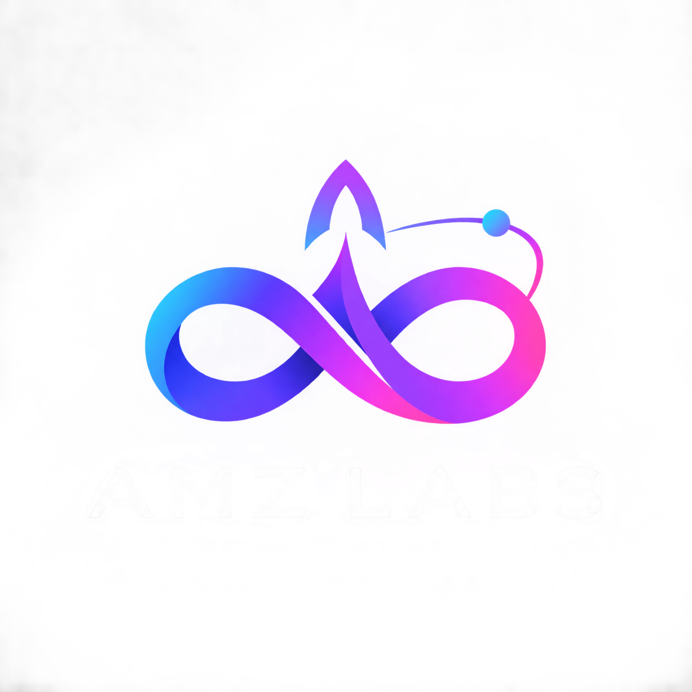
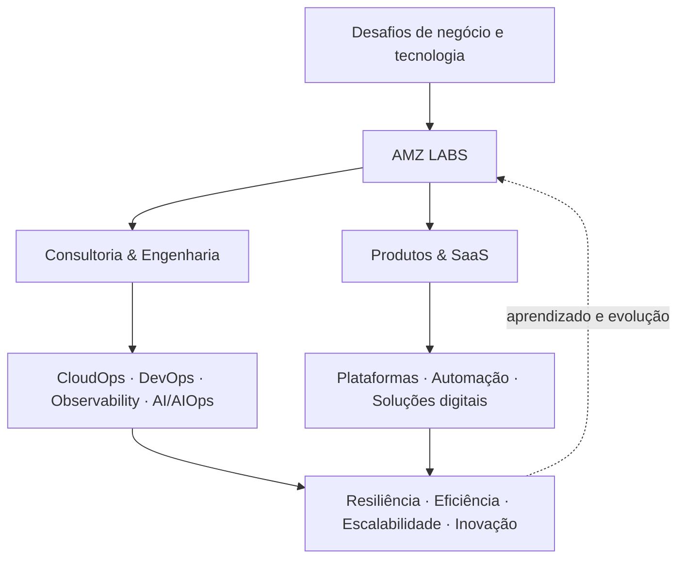

  

  <h1>AMZ LABS</h1>
  <h3>Engineering Intelligence. Building the Future.</h3>

  

    <strong>Transformamos complexidade tecnológica em engenharia inteligente, operações confiáveis e soluções escaláveis.</strong>
  

  

    Cloud Engineering · DevOps & Platform Engineering · Observability & SRE · AI & AIOps
  

  

    
    
    
    
  

---

## Tecnologia com visão de negócio. Engenharia com propósito.

A **Amz Labs** nasce para conectar o que muitas organizações ainda tratam separadamente: **infraestrutura, desenvolvimento, confiabilidade operacional e inteligência artificial**.

Somos uma empresa de **consultoria e engenharia de tecnologia** com uma segunda vertente voltada à **criação de plataformas, automações e produtos SaaS**. Atuamos para que a tecnologia deixe de ser apenas um centro de sustentação e se torne uma capacidade estratégica de evolução do negócio.

> **Não construímos tecnologia pela tecnologia. Projetamos soluções para operar melhor, escalar com segurança, acelerar entregas e criar novas possibilidades.**

Nossa visão combina profundidade técnica, execução próxima ao cliente e mentalidade de produto: **entender o desafio, desenhar a arquitetura, implementar com excelência, observar continuamente e evoluir com dados.**

## Quatro especialidades. Um ecossistema integrado.

<table>
  <tr>
    <td width="50%" valign="top">
      <h3>☁️ CloudOps & Cloud Engineering</h3>
      
Arquitetura, modernização e operação de ambientes cloud, com foco em <strong>resiliência, segurança, governança, escalabilidade e eficiência de custos</strong>.

      Cloud Architecture · Infrastructure as Code · Kubernetes · FinOps · Cloud Operations
    </td>
    <td width="50%" valign="top">
      <h3>♾️ DevOps & Platform Engineering</h3>
      
Conectamos engenharia de software e operações por meio de <strong>automação, plataformas internas, pipelines e práticas que aceleram entregas com qualidade</strong>.

      CI/CD · IaC · GitOps · Developer Experience · Platform Automation
    </td>
  </tr>
  <tr>
    <td width="50%" valign="top">
      <h3>📈 Observability & Site Reliability</h3>
      
Transformamos telemetria em visibilidade operacional, apoiando a <strong>detecção de falhas, o diagnóstico, a gestão de desempenho e a confiabilidade dos serviços</strong>.

      Metrics · Logs · Traces · OpenTelemetry · SLI/SLO · Incident Analysis
    </td>
    <td width="50%" valign="top">
      <h3>🧠 Artificial Intelligence & AIOps</h3>
      
Exploramos e desenvolvemos aplicações de inteligência artificial para <strong>automatizar processos, enriquecer diagnósticos e ampliar a capacidade de decisão e operação</strong>.

      AI Engineering · AIOps · Intelligent Automation · AI-Assisted Operations
    </td>
  </tr>
</table>

**Nosso diferencial está na integração.** Cloud provê a fundação; DevOps acelera a entrega; Observabilidade traz consciência operacional; IA potencializa a automação e a tomada de decisão. Essas capacidades se retroalimentam para gerar resultados sustentáveis.

## Duas vertentes de negócio. Uma mesma ambição.

| **Consultoria & Serviços de Engenharia** | **Produtos Digitais & SaaS** |
| :--- | :--- |
| Projetos especializados, arquitetura e implementação | Desenvolvimento de soluções próprias e plataformas reutilizáveis |
| Serviços gerenciados e evolução contínua de ambientes | Automação, ferramentas e experiências orientadas a produto |
| Alocação de profissionais e especialistas em projetos de clientes | Soluções escaláveis para desafios recorrentes do mercado |
| Conhecimento técnico aplicado ao contexto de cada operação | Aprendizado de campo transformado em propriedade intelectual |

Nosso modelo de atuação abrange tanto **projetos conduzidos pela Amz Labs** quanto **alocação especializada de consultores** em operações de clientes, conforme as necessidades e os acordos de cada parceria.

## Nosso jeito de construir

- **Engineering first.** Decisões técnicas com critério, simplicidade e sustentabilidade.
- **Security & reliability by design.** Segurança, rastreabilidade e confiabilidade desde a concepção.
- **Automation as a principle.** Reduzimos tarefas repetitivas e priorizamos processos reproduzíveis.
- **Observability by default.** Não basta colocar em produção: é preciso compreender o comportamento real dos sistemas.
- **Product mindset.** Construímos soluções que possam evoluir, gerar valor recorrente e ampliar impacto.
- **Collaboration & ownership.** Times multidisciplinares, responsabilidade clara e conhecimento compartilhado.

## O futuro que estamos construindo

A Amz Labs foi concebida para crescer além da prestação de serviços. Nosso caminho de evolução contempla:

**01 · Excelência em serviços** — Consolidar capacidades especializadas em Cloud, DevOps, Observabilidade e IA.

**02 · Tecnologia proprietária** — Transformar experiências de campo em frameworks, plataformas, automações e soluções SaaS.

**03 · Conhecimento que escala** — Expandir o ecossistema para iniciativas educacionais, com formação e conteúdos em tecnologia e, futuramente, marketing.

> **Nossa visão é desenvolver uma empresa capaz de operar tecnologia, criar tecnologia e compartilhar tecnologia.**

## Nosso GitHub: onde a engenharia ganha forma

Esta organização centraliza, progressivamente, nosso ecossistema de tecnologia: **código, arquitetura, documentação, padrões de engenharia, automações, produtos e iniciativas de pesquisa e desenvolvimento**.

Trabalhamos para que cada repositório tenha um propósito claro, documentação útil, histórico rastreável e práticas adequadas de segurança e colaboração. Entregáveis privados de clientes permanecem segregados, respeitando acordos de confidencialidade, permissões e propriedade intelectual.

  <h3>Build. Observe. Automate. Scale.</h3>
  
<strong>AMZ LABS</strong> — Engineering Intelligence. Building the Future.

  
<a href="https://github.com/Amz-Labs">Explore nossa organização no GitHub</a>

