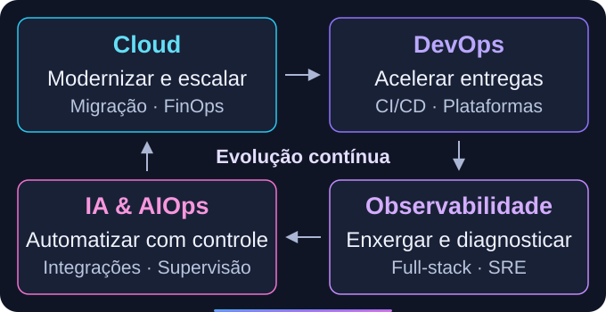

  
  <h1>AMZ LABS</h1>
  
<strong>Engineering Intelligence. Building the Future.</strong>

  <h3>Tecnologia para operar melhor e crescer com confiança.</h3>
  
Somos uma empresa de consultoria e engenharia que integra 
  <strong>Cloud, DevOps, Observabilidade e Inteligência Artificial.</strong>

  
Modernizamos ambientes, automatizamos entregas e transformamos 
  dados operacionais em decisões — da arquitetura à evolução contínua.

  
<a href="mailto:amzlabs@icloud.com"><strong>Vamos conversar sobre seu desafio →</strong></a>

---

## Engenharia integrada. Valor em cada etapa.

  

Uma migração cloud pode incluir **pipelines automatizados, observabilidade full-stack e práticas de SRE**, com IA apoiando o diagnóstico. As especialidades trabalham juntas para dar mais previsibilidade à sua operação.

[Explore nossas soluções de engenharia →](../docs/services.md)

## O modelo certo para o seu momento

- **Diagnósticos e projetos:** da avaliação técnica à implementação, com escopo e entregáveis definidos.
- **Serviços gerenciados:** sustentação e melhoria contínua, conforme as necessidades da operação.
- **Especialistas e squads:** profissionais alocados para ampliar a capacidade do seu time.

[Conheça os modelos de atuação →](../docs/engagement-models.md)

## Tecnologia escolhida pelo seu desafio

Combinamos plataformas **SaaS, enterprise e open source**, com arquitetura orientada aos requisitos do cliente. Segurança, automação e confiabilidade fazem parte do desenho da solução.

[Conheça nosso ecossistema tecnológico →](../docs/technology-ecosystem.md)

**Nossa próxima fronteira:** transformar conhecimento de engenharia em automações, frameworks e produtos SaaS próprios. Uma direção de evolução da Amz Labs.

---

  
<strong>Seu próximo desafio começa com uma conversa.</strong> 
  Projetos · Especialistas · Parcerias

  
<a href="mailto:amzlabs@icloud.com">amzlabs@icloud.com</a>

  Build. Observe. Automate. Scale.

